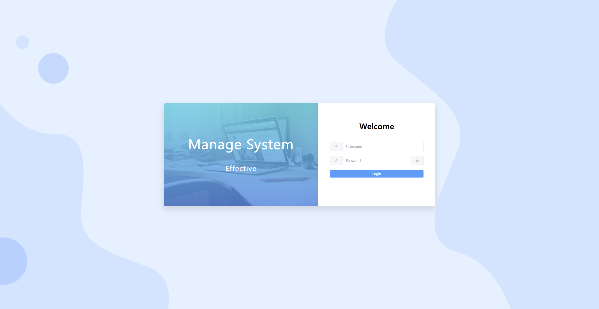
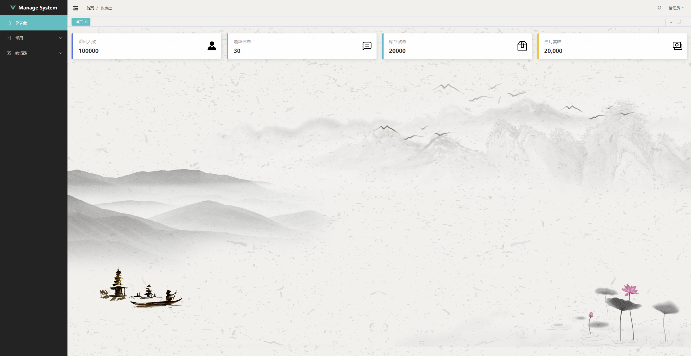
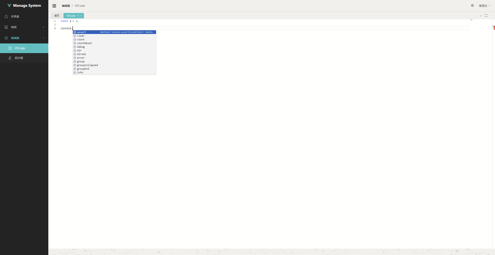
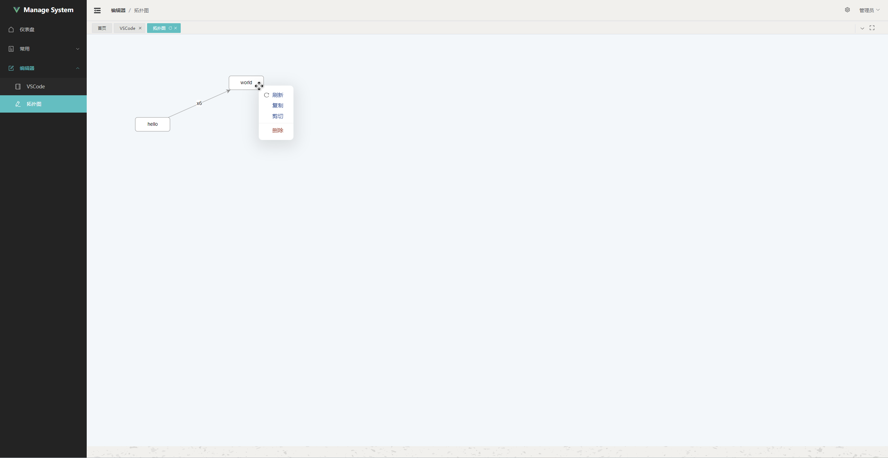

# 简介

Vue 3 + Vite + TypeScript + Pinia + ElementPlus

一款简洁的后台管理系统，添加常用的组件，如markdown编辑器vditor、富文本编辑器wangEditor、图编辑器antv x6、代码编辑器monaco-editor等。

# 安装

```shell
pnpm install
pnpm run dev
```

# 脚本

```shell
pnpm run dev         # 启动开发服务
pnpm run build       # 类型检查 + 生产构建
pnpm run build:only  # 仅生产构建，跳过类型检查
pnpm run type-check  # vue-tsc 类型检查
pnpm run lint        # eslint 代码检查
pnpm run serve       # 预览构建产物
```

# 预览









# License

vue-admin-box 1.x, which was forked from: [vue-admin-box](https://github.com/cmdparkour/vue-admin-box) which branch is [template-js](https://github.com/cmdparkour/vue-admin-box/tree/template-js).

Vue3-admin-box 2.x, I fixed some bugs and tried upgrading with some new components.
